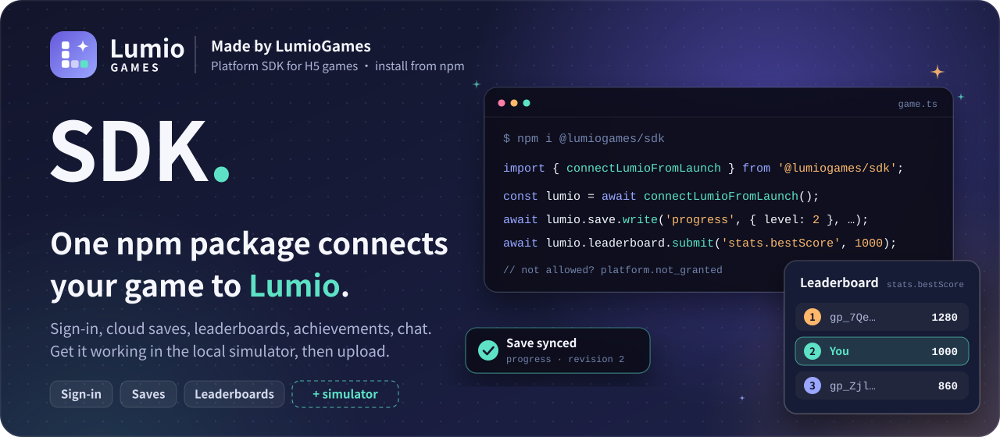
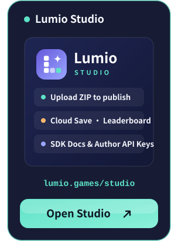
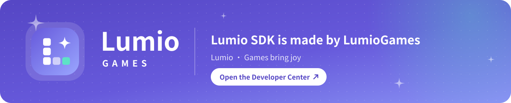

<div align="center">

<a href="https://lumio.games/studio/"></a>

**[npm](https://www.npmjs.com/package/@lumiogames/sdk)** &nbsp;·&nbsp; **[LumioTemplate](https://github.com/LumioGames/LumioTemplate)** &nbsp;·&nbsp; **[LGUI](https://github.com/LumioGames/LGUI)** &nbsp;·&nbsp; English &nbsp;·&nbsp; [简体中文](README.md)

[![Made by LumioGames](https://img.shields.io/badge/made%20by-LumioGames-6659DB?style=flat-square&labelColor=171C34&logo=data%3Aimage%2Fsvg%2Bxml%3Bbase64%2CPHN2ZyB4bWxucz0iaHR0cDovL3d3dy53My5vcmcvMjAwMC9zdmciIHZpZXdCb3g9IjAgMCAxMDAgMTAwIiB3aWR0aD0iOTYiIGhlaWdodD0iOTYiPjxkZWZzPjxsaW5lYXJHcmFkaWVudCBpZD0iZyIgeDE9IjAiIHkxPSIwIiB4Mj0iMSIgeTI9IjEiPjxzdG9wIG9mZnNldD0iMCIgc3RvcC1jb2xvcj0iIzY2NTlkYiIvPjxzdG9wIG9mZnNldD0iMSIgc3RvcC1jb2xvcj0iIzlhYTZmZiIvPjwvbGluZWFyR3JhZGllbnQ%2BPC9kZWZzPjxyZWN0IHdpZHRoPSIxMDAiIGhlaWdodD0iMTAwIiByeD0iMjkiIGZpbGw9InVybCgjZykiLz48cmVjdCB4PSIyNSIgeT0iMjIiIHdpZHRoPSIxNiIgaGVpZ2h0PSIxNiIgcng9IjQiIGZpbGw9IiNmZmYiLz48cmVjdCB4PSIyNSIgeT0iNDIiIHdpZHRoPSIxNiIgaGVpZ2h0PSIxNiIgcng9IjQiIGZpbGw9IiNmZmYiLz48cmVjdCB4PSIyNSIgeT0iNjIiIHdpZHRoPSIxNiIgaGVpZ2h0PSIxNiIgcng9IjQiIGZpbGw9IiNmZmYiLz48cmVjdCB4PSI0NSIgeT0iNjIiIHdpZHRoPSIxNiIgaGVpZ2h0PSIxNiIgcng9IjQiIGZpbGw9IiNmZmYiIGZpbGwtb3BhY2l0eT0iLjYiLz48cmVjdCB4PSI2NSIgeT0iNjIiIHdpZHRoPSIxNiIgaGVpZ2h0PSIxNiIgcng9IjQiIGZpbGw9IiM1ZGUyYzYiLz48cGF0aCBkPSJNNzAgMTlDNzEuNTYgMjguMSA3My45IDMwLjQ0IDgzIDMyQzczLjkgMzMuNTYgNzEuNTYgMzUuOSA3MCA0NUM2OC40NCAzNS45IDY2LjEgMzMuNTYgNTcgMzJDNjYuMSAzMC40NCA2OC40NCAyOC4xIDcwIDE5WiIgZmlsbD0iI2ZmZiIvPjwvc3ZnPgo%3D)](https://lumio.games/studio/)
[](https://www.npmjs.com/package/@lumiogames/sdk)
[](https://nodejs.org/)
[](#install)
[](#license)

</div>

<h3 align="center">Join the developer community · Visit Studio</h3>

<p align="center">
  <a href="https://qm.qq.com/q/PGkXh4tCyQ"></a>
  <a href="https://applink.feishu.cn/client/chat/chatter/add_by_link?link_token=b24vf257-5a2b-41ce-935e-bc4ce19dc396"></a>
  <a href="https://lumio.games/studio/"></a>
</p>

---

## What Lumio SDK is

Lumio SDK (npm package `@lumiogames/sdk`) is the platform SDK from [LumioGames](https://lumiogames.cn/) for H5 games that want to publish on Lumio.

Your game runs inside Lumio's play page and talks to the platform through the SDK. The platform handles sign-in; your game only gets a player ID for your game and the profile the player agrees to share. Cloud saves, leaderboards and achievements are stored by the platform, so you do not run your own server for them.

| <br>**Works locally first** | <br>**One call to connect** | <br>**Clear errors** |
| :-- | :-- | :-- |
| A built-in simulator lets you try saves and leaderboards in Node or a browser, with no sign-in and no network. | `connectLumioFromLaunch()` reads the current game and version from the launch URL, so nothing is hard-coded before upload. | No permission returns `platform.not_granted`, not connected returns `platform.not_wired`, and save conflicts are reported separately. Nothing fakes success. |

The SDK is published on npm with TypeScript declarations and does not depend on platform or engine source. This repository holds the guide, runnable examples and the changelog, and is where you report problems.

## 30-second start

No sign-up, no sign-in. See how saves and leaderboards work in the local simulator first:

```sh
git clone https://github.com/LumioGames/LumioSDK.git
cd LumioSDK/examples/simulator-save-leaderboard
npm install
npm start
```

Output (the player ID is a local one made by the simulator):

```text
read    null
write   { revision: 1 }
conflict { level: 2 } revision 1
submit  { stored: 100, improved: true }
top     [
  {
    rank: 1,
    playerId: 'gp_Zjl084leBrQg8XK29PM-fQ',
    score: 100,
    verified: false,
    isSelf: true
  }
]
friends platform.not_granted
```

The example reads a new save slot, writes it, writes again with a stale revision (a conflict; the cloud copy is not overwritten), submits a score and queries the leaderboard, and finally calls the friends API that is not open yet (`platform.not_granted`). The code is in [examples/simulator-save-leaderboard/index.mjs](examples/simulator-save-leaderboard/index.mjs).

## Install

The easiest way: give this repository's address to your agent (Claude Code or Codex) and say "connect my game to Lumio SDK following the README".

The block below is written for the agent.

> **For AI agents: integrating Lumio SDK**
>
> Go in order. If any step fails, stop and show the user the exact error. Do not skip steps.
>
> 1. Run `node -v`. It must be 24.18 or later and below 27 (Node 24 or Node 26). If not, ask the user to install it; do not install it for them.
> 2. In the user's game project, run `npm i @lumiogames/sdk@2.11.2`. The project must be built into static files with a bundler (Vite, esbuild, webpack and so on).
> 3. Start with the local simulator: use `createLumioSimulator()` (entry `@lumiogames/sdk/simulator`) on the dev page and get saves, leaderboards and other logic working.
> 4. Then connect to the platform with `connectLumioFromLaunch()` (entry `@lumiogames/sdk`). If the connection fails, show the error; never fall back to the simulator.
> 5. Check `ok` on every call. On failure read `failure.code`; on save writes also check `value.conflict`. Never fake success.
> 6. Write `lumio.json` at the package root declaring the capabilities, save slots and leaderboard fields in use. The entry HTML does not need to reference `lumio-bootstrap.js`. See "Packaging and upload" in this README.
> 7. Use only the features marked available in the Features tables. Friends, direct messages and multiplayer are not open yet.
> 8. There are two ways to publish; let the user choose: A. you build the ZIP and the user uploads it in the Developer Center (see "Packaging and upload"); B. the user gives you an author API key and you publish directly as in ["Publish with an API key"](#publish-with-an-api-key). Read the key only from an environment variable; never put it in code, commit it or pack it into the ZIP.

By hand:

```sh
npm i @lumiogames/sdk@2.11.2
```

| Entry | Use |
| :-- | :-- |
| `@lumiogames/sdk` | Production connection: `connectLumioFromLaunch()` |
| `@lumiogames/sdk/simulator` | Local simulator: `createLumioSimulator()` |
| `@lumiogames/sdk/adapters` | Small adapters for Cocos, Phaser, Godot and Unity |

The package needs Node 24.18 or later (below 27; Node 24 or Node 26), only for development and builds. You upload the built static files; players' browsers never read `node_modules`.

## Features

### Available

| Feature | API | `lumio.json` capability |
| :-- | :-- | :-- |
| Sign-in state | `lumio.session` (`signedIn`, `capabilities`) | `identity.basic` |
| Player profile | `players.requestProfile()`, `players.get()`; nickname and avatar only after the player agrees | `identity.profile` |
| Cloud saves | `save.read()`, `save.write()`, with revisions; conflicts never overwrite the cloud copy | `save` |
| Game data | `data.read()`, `data.write()` | `data` |
| Leaderboards | `leaderboard.submit()`, `leaderboard.query()` | `leaderboard` |
| Achievements | `achievements.list()`, `achievements.unlock()` | `achievement` |
| Game-wide and room chat | `chat.send()`, `chat.history()`, `chat.onMessage()`; `global` is the current game's channel | `chat.game` |

### Not available yet

| Feature | Notes |
| :-- | :-- |
| Friends | Platform apps only; third-party calls return `platform.not_granted` |
| Direct messages | Same; declaring `chat.direct` in `lumio.json` does not grant it |
| Multiplayer | Room chat needs the player to actually be in a room; it cannot create multiplayer rooms |

The package contains other methods too. Having a method does not mean having permission; the tables above are what is available. Guests (players who are not signed in) cannot write cloud saves, leaderboards or social data.

## Connecting to the platform

When your game runs in Lumio's play page, connect with `connectLumioFromLaunch()`:

```ts
import { connectLumioFromLaunch } from '@lumiogames/sdk';

const lumio = await connectLumioFromLaunch();

if (!lumio.session.signedIn) {
  // Guest: cannot write cloud saves or leaderboards; ask the player to sign in
}

const profile = await lumio.players.requestProfile(); // the platform asks the player; on consent you get nickname and avatar
if (!profile.ok) console.warn(profile.failure.code);

// When the scene unloads, release the connection, listeners and uploads
lumio.dispose();
```

- There is no username/password sign-in API for games; the platform owns the sign-in and consent screens. Your game gets a `gp_…` player ID for your game and the profile the player agreed to share. It never gets the account ID, UID, email, cookies or match tickets.
- Check `lumio.session.capabilities` before calling: `available` works, `not_granted` is not permitted, `not_wired` is not connected.
- Loading screen: once connected, the SDK shows download progress from the bytes downloaded so far and reports page errors to the platform. To report your own progress, call `lumio.loading.progress(loaded, total)`. To keep the loading screen up until your assets are ready, connect with `connectLumioFromLaunch({ loading: 'manual' })` and call `lumio.loading.ready()` when ready.

### Cloud saves and conflicts

```ts
const saved = await lumio.save.read('progress');
if (!saved.ok) throw new Error(saved.failure.code);

const result = await lumio.save.write('progress', { level: 2 }, {
  expectedRevision: saved.value?.revision ?? null, // null for a new slot
});
if (!result.ok) throw new Error(result.failure.code);
if ('conflict' in result.value) {
  // The cloud has a newer save: keep the player's current progress, read again, let the player choose
  console.warn('Save conflict', result.value.conflict);
}
```

Pass the `expectedRevision` you actually read. A result with `ok: true` can still contain `value.conflict`; do not overwrite the cloud save automatically.

### Leaderboards

The leaderboard for field `bestScore` is named `stats.bestScore`. Scores submitted by the client have `verified: false`; only scores written by the platform's game server show as verified.

## Packaging and upload

Put `index.html`, `lumio.json` and the files the game needs at the root of the ZIP, with no extra project folder around them. Declare every capability, save slot and leaderboard field you use in `lumio.json`:

```json
{
  "entry": "index.html",
  "engine": false,
  "capabilities": ["identity.basic", "identity.profile", "save", "data", "leaderboard", "achievement", "chat.game"],
  "network": { "connect": [] },
  "data": {
    "fields": {
      "bestScore": {
        "type": "int",
        "min": 0,
        "max": 999999,
        "writer": "player",
        "visibility": "public",
        "leaderboard": { "order": "desc", "maxSubmitPerMinute": 6 }
      }
    },
    "slots": {
      "progress": { "maxBytes": 32768, "maxKeys": 128, "maxDepth": 6, "writer": "player", "visibility": "self" }
    }
  },
  "achievements": { "first_win": { "writer": "player" } }
}
```

- Plain H5 games use `engine: false`. `capabilities` lists capability names; `sdk` is not a version field.
- Leaderboard fields must have a value range and a per-minute submit limit.
- List external network origins as exact `https://` or `wss://` addresses, with no wildcards and no platform domains.

The entry HTML does not need to reference the platform's startup script `lumio-bootstrap.js`; with SDK 2.11 or later, the SDK handles loading-screen progress and error reports. An existing reference can stay. The platform reserves the package-root path `lumio-bootstrap.js`, so do not put a file with that name in your ZIP.

To upload:

1. Sign in to the [Developer Center](https://lumiogames.cn/studio/), apply as an author, create a game and fill in its details.
2. On the game's Versions page, choose the ZIP, enter the version number and release notes, and click Upload.
3. When the checks finish, select the draft version and click Submit for review.
4. See the review result and any requested changes in the version history. Submitting is not the same as going live; the live version shown in the Developer Center is what players get.

## Publish with an API key

Besides uploading a ZIP by hand in the Developer Center, an AI agent or a script can publish with an author API key: one key creates the game, uploads it, edits its details, submits it for review and checks whether it went live. The essentials are below; the full guide is the platform document [author-api.md](https://lumiogames.cn/assets/studio/docs/author-api.md) (in Chinese).

**1. Get a key**

- Apply as an author first, then create a key on the Developer Center's [author API keys](https://lumiogames.cn/studio/settings/credentials) page. It needs at least the five scopes below, and the game scope must be "all my games", because the game has no game key yet when you create it. You can also restrict IPs and set an expiry; the key never has more permissions than you have in your team.

  ```json
  {
    "purpose": "author",
    "scopes": ["games.create", "games.upload", "games.metadata.update", "games.submit", "games.review.read"],
    "gameScope": { "mode": "all" }
  }
  ```

- The key is shown once and looks like `lmo_api_…`. Keep it only in an environment variable or a private file on your machine that only you can read. Never put it in code, commit it, pack it into the ZIP, or show it in command-line arguments, screenshots or logs.
- Old `agent:publish` credentials return `credential_legacy`; create a new author API key.

**2. Request order**

Every request carries `Authorization: Bearer <key>` except the file PUT, which carries neither the key nor cookies. Give each POST and PATCH its own fixed `Idempotency-Key`, and reuse that key when you resend the same request.

| Step | Request | Body and checks |
| :-- | :-- | :-- |
| 1. Create the game | `POST /api/v2/publish/games` | `{title,slug}`; `slug` is optional. Use the `gameKey` from the response |
| 2. Request an upload | `POST /api/v2/publish/games/:gameKey/uploads` | `{purpose:"package",label,maxBytes,contentType:"application/zip",releaseNotes}`; use `label` `1.0.0` for the first version, and `maxBytes` must equal the ZIP's real size in bytes |
| 3. Upload the file | `PUT <uploadUrl>` | Use the exact `uploadUrl` and `headers` from the response and PUT the raw file, not multipart. The ticket is valid for 24 hours (`expiresAt`); if the PUT breaks, PUT the whole file to the same `uploadUrl` again |
| 4. Complete the upload | `POST /api/v2/publish/games/:gameKey/uploads/:uploadId/complete` | `{}`; `unpacking` only means the platform accepted it |
| 5. Wait for processing | `GET /api/studio/games/:gameKey/uploads/:uploadId` | Poll until `stage=complete` and `failed=false`, and keep the `versionId`; on `failed=true`, fix the package per `reason` and upload again |
| 6. Edit details | `GET`, then `PATCH /api/v2/publish/games/:gameKey/metadata` | GET returns only `{gameKey,revision}`; PATCH sends `expectedRevision` (that `revision`) plus the fields to change. It took effect only if the response is `applied` with `baseRevision` equal to `expectedRevision` |
| 7. Submit for review | `POST /api/v2/publish/games/:gameKey/versions/:versionId/submit` | `{}`; check that the response's `gameKey` and `versionId` match and `packageHash` equals the ZIP's SHA256 |
| 8. Read the review | `GET /api/studio/games/:gameKey/versions/:versionId/review` | On `checking` or `pending`, check again later with a retry limit; only `approved` means approved. A 404 right after submitting only means the review is not visible yet |
| 9. Confirm it is live | `GET /api/play/:gameKey/launch` | It is live only when this returns your `gameKey` and `versionId`; then open the returned `frameUrl` to check the page |

The first release needs `oneLiner` (one sentence, at most 40 characters), `category`, `orientation` (`landscape`, `portrait` or `both`) and `coverKey`. `category` is one of `休闲` `解谜` `动作` `冒险` `角色扮演` `策略` `模拟经营` `射击` `对战` `撤离` `竞速` `体育` `卡牌` `塔防` `音乐` `剧情` `恐怖` `益智` `其他`. Optional: `title`, `screenshotKeys`, `videoKey`, `tags`, `descriptionMd`.

Cover, screenshots and video go through steps 2 to 5 as well, with `purpose` set to `cover`, `screenshot` or `video` and `contentType` set to the file's real type (`image/png`, `image/jpeg`, `image/webp`, `video/mp4`, `video/webm`). When done, put the response's `objectKey` into the details. The cover is 16:9; up to 5 screenshots; video up to 3 minutes.

To update a game, do not create a new one: start at step 2 with a package whose version is higher than the last, edit details if needed, and submit.

**3. When something fails**

| Response | What to do |
| :-- | :-- |
| `429 platform.budget` | The platform server is busy. Wait for the seconds in the `Retry-After` header and resend the same request with the same `Idempotency-Key`, at most 3 times |
| `429 platform.quota_exceeded` | Over the rate quota (by default 120 requests per minute per key). Do not retry automatically; slow down |
| `platform.studio.metadata_incomplete` | The first release is missing details; `reason` lists them. Fill them in and submit again |
| `platform.forbidden` with a `reason` starting with `content_` | The details failed the content check; change the text or image and save again |
| `platform.conflict` | The details changed since you read them; GET again and decide what to change |
| Any other failure, or a review result of `failed`, `changes_requested` or `superseded` | Stop, do not retry automatically, and give the user the `gameKey`, `uploadId`, `versionId` and `requestId` |

On Windows you can use the platform's curl example script `author-publish.ps1`; see section 5 of the full guide for how to download and run it.

## Common errors

| What you see | Meaning | What to do |
| :-- | :-- | :-- |
| `failure.code` is `platform.not_granted` | No permission: the player has not agreed, is a guest, or the feature is not open to third parties | Ask the player to sign in or agree; do not call features that are not available yet |
| `failure.code` is `platform.not_wired` | The feature is not connected in this environment | Show a clear message; do not fake success |
| `save.write` returns `ok: true` with `value.conflict` | The cloud save is newer than the one you read | Keep current progress, read again, let the player choose |

## Known limits

- Simulator data lives in memory only and is gone after a page reload or a new simulator; every result carries `simulated: true`.
- The simulator does not fully enforce the platform's declaration, permission, quota and rate checks. Upload a real game package to verify before release. Do not turn on the `firstParty` option when building a third-party game.
- Friends, direct messages and multiplayer are not open to third parties yet; see the Features tables.

## Versions and updates

- The SDK is published only on npm. A published version never changes; fixes and new features come as new versions.
- Install with a full version number and upgrade when you choose; `npm outdated` shows whether a newer one exists. Add `--save-exact` to pin it in `package.json` too.
- Each version's changes are in the [changelog](CHANGELOG.md), and this repository tags each version with the same name (for example `v2.11.1`).

## Docs

| Doc | Contents |
| :-- | :-- |
| "Docs and Lumio SDK" on the [Developer Center](https://lumiogames.cn/studio/) | Full feature reference and the author API publishing flow |
| [Simulator example](examples/simulator-save-leaderboard/index.mjs) | Saves, conflicts, leaderboards, and what closed features return |
| [LumioTemplate](https://github.com/LumioGames/LumioTemplate) | Blank game template; click Use this template to start |
| [Changelog](CHANGELOG.md) · [Contributing](CONTRIBUTING.md) | |

## License

Lumio SDK is source-available under the [PolyForm Shield License 1.0.0](https://polyformproject.org/licenses/shield/1.0.0), with an Additional Permission and a Trademarks notice from LumioGames. The full text is in [LICENSE](LICENSE). In short:

| You may | You may not |
| :-- | :-- |
| Use Lumio SDK in games, apps and websites, including paid commercial products | Use Lumio SDK or a changed version to build a competing game SDK, game platform, game publishing or hosting service, or game development tool, paid or free |
| Star, fork, change and send pull requests; use it for learning, teaching and research | Republish it under another name or skin, or change it to connect to another platform |
| Say "uses Lumio SDK" or "published on Lumio" in your game | Use the Lumio or LumioGames names and logos as your own brand |

For any other use, contact us through the [Developer Center](https://lumiogames.cn/studio/) or the community groups above for a separate license. The English text in LICENSE is what counts.

<br>

<p align="center"><a href="https://lumio.games/studio/"></a></p>
