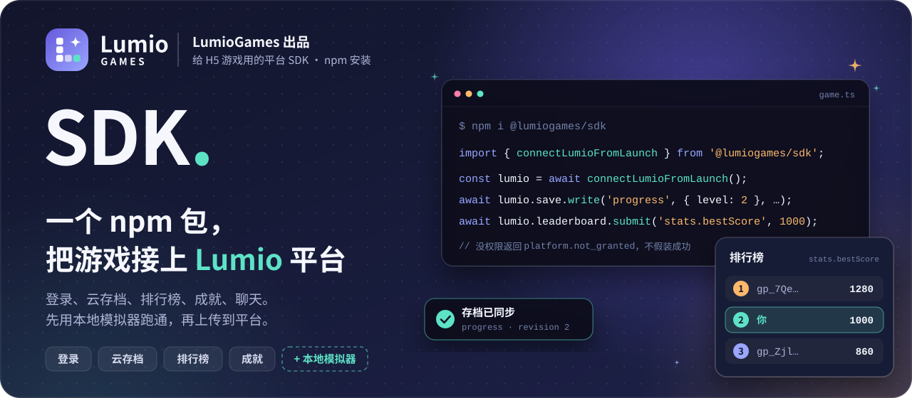
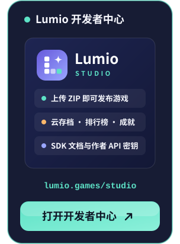

<div align="center">

<a href="https://lumio.games/studio/"></a>

**[npm](https://www.npmjs.com/package/@lumiogames/sdk)** &nbsp;·&nbsp; **[LumioTemplate](https://github.com/LumioGames/LumioTemplate)** &nbsp;·&nbsp; **[LGUI](https://github.com/LumioGames/LGUI)** &nbsp;·&nbsp; [English](README.en.md) &nbsp;·&nbsp; 简体中文

[![LumioGames 出品](https://img.shields.io/badge/LumioGames-%E5%87%BA%E5%93%81-6659DB?style=flat-square&labelColor=171C34&logo=data%3Aimage%2Fsvg%2Bxml%3Bbase64%2CPHN2ZyB4bWxucz0iaHR0cDovL3d3dy53My5vcmcvMjAwMC9zdmciIHZpZXdCb3g9IjAgMCAxMDAgMTAwIiB3aWR0aD0iOTYiIGhlaWdodD0iOTYiPjxkZWZzPjxsaW5lYXJHcmFkaWVudCBpZD0iZyIgeDE9IjAiIHkxPSIwIiB4Mj0iMSIgeTI9IjEiPjxzdG9wIG9mZnNldD0iMCIgc3RvcC1jb2xvcj0iIzY2NTlkYiIvPjxzdG9wIG9mZnNldD0iMSIgc3RvcC1jb2xvcj0iIzlhYTZmZiIvPjwvbGluZWFyR3JhZGllbnQ%2BPC9kZWZzPjxyZWN0IHdpZHRoPSIxMDAiIGhlaWdodD0iMTAwIiByeD0iMjkiIGZpbGw9InVybCgjZykiLz48cmVjdCB4PSIyNSIgeT0iMjIiIHdpZHRoPSIxNiIgaGVpZ2h0PSIxNiIgcng9IjQiIGZpbGw9IiNmZmYiLz48cmVjdCB4PSIyNSIgeT0iNDIiIHdpZHRoPSIxNiIgaGVpZ2h0PSIxNiIgcng9IjQiIGZpbGw9IiNmZmYiLz48cmVjdCB4PSIyNSIgeT0iNjIiIHdpZHRoPSIxNiIgaGVpZ2h0PSIxNiIgcng9IjQiIGZpbGw9IiNmZmYiLz48cmVjdCB4PSI0NSIgeT0iNjIiIHdpZHRoPSIxNiIgaGVpZ2h0PSIxNiIgcng9IjQiIGZpbGw9IiNmZmYiIGZpbGwtb3BhY2l0eT0iLjYiLz48cmVjdCB4PSI2NSIgeT0iNjIiIHdpZHRoPSIxNiIgaGVpZ2h0PSIxNiIgcng9IjQiIGZpbGw9IiM1ZGUyYzYiLz48cGF0aCBkPSJNNzAgMTlDNzEuNTYgMjguMSA3My45IDMwLjQ0IDgzIDMyQzczLjkgMzMuNTYgNzEuNTYgMzUuOSA3MCA0NUM2OC40NCAzNS45IDY2LjEgMzMuNTYgNTcgMzJDNjYuMSAzMC40NCA2OC40NCAyOC4xIDcwIDE5WiIgZmlsbD0iI2ZmZiIvPjwvc3ZnPgo%3D)](https://lumio.games/studio/)
[](https://www.npmjs.com/package/@lumiogames/sdk)
[](https://nodejs.org/)
[](#安装)
[](#许可)

</div>

<h3 align="center">加入开发者社群 · 访问官网</h3>

<p align="center">
  <a href="https://qm.qq.com/q/PGkXh4tCyQ"></a>
  <a href="https://applink.feishu.cn/client/chat/chatter/add_by_link?link_token=b24vf257-5a2b-41ce-935e-bc4ce19dc396"></a>
  <a href="https://lumio.games/studio/"></a>
</p>

---

## Lumio SDK 是什么

Lumio SDK（npm 包 `@lumiogames/sdk`）是 [LumioGames](https://lumiogames.cn/) 出品的平台 SDK，给想在 Lumio 上发布的 H5 游戏用。

游戏跑在 Lumio 的游玩页里，通过 SDK 和平台通信。玩家登录由平台负责，游戏只拿到本游戏的玩家号和玩家同意给的资料；云存档、排行榜、成就这些数据存在平台上，游戏不用自己搭服务器。

| <br>**本地先跑通** | <br>**一行连上平台** | <br>**错误说清楚** |
| :-- | :-- | :-- |
| 自带本地模拟器，在 Node 或浏览器里就能试存档和排行榜，不用登录，不联网。 | `connectLumioFromLaunch()` 从启动地址读出当前游戏和版本，上传前不用写死版本号。 | 没权限返回 `platform.not_granted`，没接通返回 `platform.not_wired`，存档冲突单独返回，不会假装成功。 |

SDK 通过 npm 发布，自带 TypeScript 类型声明，不依赖平台或引擎源码。这个仓库放使用说明、可运行的示例和更新记录，问题也在这里反馈。

## 30 秒上手

不用注册，不用登录，先在本地模拟器里看一遍存档和排行榜怎么用：

```sh
git clone https://github.com/LumioGames/LumioSDK.git
cd LumioSDK/examples/simulator-save-leaderboard
npm install
npm start
```

输出（玩家号是模拟器生成的本地号）：

```text
read    null
write   { revision: 1 }
conflict { level: 2 } revision 1
submit  { stored: 100, improved: true }
top     [
  {
    rank: 1,
    playerId: 'gp_Zjl084leBrQg8XK29PM-fQ',
    score: 100,
    verified: false,
    isSelf: true
  }
]
friends platform.not_granted
```

示例依次做了：读一个新存档，写入，再用过期的 revision 写一次（得到冲突，云端没被覆盖），提交分数并查排行榜，最后调用暂不开放的好友接口（得到 `platform.not_granted`）。代码见 [examples/simulator-save-leaderboard/index.mjs](examples/simulator-save-leaderboard/index.mjs)。

## 安装

最省事的办法：把这个仓库的地址发给你的 Agent（Claude Code、Codex 都行），说一句「照 README 给我的游戏接上 Lumio SDK」。

下面这段是写给 Agent 看的。

> **给 AI Agent：接入 Lumio SDK**
>
> 按顺序做。任何一步失败都停下，把错误原文告诉用户，不要跳过。
>
> 1. 运行 `node -v`，要求 24.18 或更高、低于 27（Node 24 或 Node 26 都可以）。没有就请用户自己装，不要替用户装。
> 2. 在用户的游戏工程里运行 `npm i @lumiogames/sdk@2.11.2`。工程要用打包工具（Vite、esbuild、webpack 等）构建成静态文件。
> 3. 先接本地模拟器：在开发页面里用 `createLumioSimulator()`（入口 `@lumiogames/sdk/simulator`），把存档、排行榜等逻辑跑通。
> 4. 再接正式平台：用 `connectLumioFromLaunch()`（入口 `@lumiogames/sdk`）。连接失败要显示错误，不要自动换成模拟器。
> 5. 每个调用都检查 `ok`；失败时看 `failure.code`，写存档还要检查 `value.conflict`。不要伪造成功。
> 6. 在包根目录写 `lumio.json`，声明用到的能力、存档槽和上榜字段；入口 HTML 不需要引用 `lumio-bootstrap.js`。写法见本 README「打包上传」一节。
> 7. 只用下面「功能」表里开放的能力。好友、私信、联机暂不开放。
> 8. 发布方式有两种，让用户选：A. 你打好 ZIP，用户自己到开发者中心上传（见「打包上传」）；B. 用户给你作者 API 密钥，你按[「用 API 密钥发布」](#用-api-密钥发布)直接发布。密钥只从环境变量读，不写进代码、不提交、不打进 ZIP。

自己装：

```sh
npm i @lumiogames/sdk@2.11.2
```

| 入口 | 用途 |
| :-- | :-- |
| `@lumiogames/sdk` | 正式平台连接：`connectLumioFromLaunch()` |
| `@lumiogames/sdk/simulator` | 本地模拟器：`createLumioSimulator()` |
| `@lumiogames/sdk/adapters` | Cocos、Phaser、Godot、Unity 的轻量适配 |

包要求 Node 24.18 或更高（低于 27，Node 24 或 Node 26 都可以），只在开发和构建时用到。上传的是构建好的静态文件，玩家浏览器不会读 `node_modules`。

## 功能

### 开放

| 功能 | 接口 | `lumio.json` 声明 |
| :-- | :-- | :-- |
| 登⁠录⁠状⁠态 | `lumio.session`（`signedIn`、`capabilities`） | `identity.basic` |
| 玩⁠家⁠资⁠料 | `players.requestProfile()`、`players.get()`，玩家同意后才有昵称和头像 | `identity.profile` |
| 云⁠存⁠档 | `save.read()`、`save.write()`，带 revision，冲突时不覆盖云端 | `save` |
| 游⁠戏⁠数⁠据 | `data.read()`、`data.write()` | `data` |
| 排⁠行⁠榜 | `leaderboard.submit()`、`leaderboard.query()` | `leaderboard` |
| 成⁠就 | `achievements.list()`、`achievements.unlock()` | `achievement` |
| 公⁠屏⁠和⁠房⁠间⁠聊⁠天 | `chat.send()`、`chat.history()`、`chat.onMessage()`；`global` 是当前游戏公屏 | `chat.game` |

### 暂不开放

| 功能 | 说明 |
| :-- | :-- |
| 好⁠友 | 只给平台自己的应用用，第三方调用返回 `platform.not_granted` |
| 私⁠信 | 同上；在 `lumio.json` 里声明 `chat.direct` 也不会获得权限 |
| 联⁠机 | 房间聊天要求玩家真的在房间里，不能用来创建联机房间 |

发行包里还有其他方法，有方法不代表有权限，以上表为准。游客（未登录玩家）不能写云存档、排行榜和社交数据。

## 接入正式平台

游戏在 Lumio 游玩页里运行时，用 `connectLumioFromLaunch()` 连接：

```ts
import { connectLumioFromLaunch } from '@lumiogames/sdk';

const lumio = await connectLumioFromLaunch();

if (!lumio.session.signedIn) {
  // 游客：不能写云存档和排行榜，提示玩家登录
}

const profile = await lumio.players.requestProfile(); // 平台弹出授权，玩家同意后返回昵称和头像
if (!profile.ok) console.warn(profile.failure.code);

// 场景卸载时释放连接、订阅和上传
lumio.dispose();
```

- 游戏没有账号密码登录接口，登录和授权界面由平台负责。游戏只拿到本游戏的 `gp_…` 玩家号和玩家同意给的资料，拿不到账号、UID、邮箱、Cookie 或入局票据。
- 调用前可以看 `lumio.session.capabilities`：`available` 可用，`not_granted` 未授权，`not_wired` 未接通。
- 加载页：SDK 连上后自动按已下载的字节显示下载进度，并把页面报错上报给平台。想自己报进度，调用 `lumio.loading.progress(loaded, total)`；想让加载页一直显示到资源准备好，连接时传 `connectLumioFromLaunch({ loading: 'manual' })`，准备好后调用 `lumio.loading.ready()`。

### 云存档和冲突

```ts
const saved = await lumio.save.read('progress');
if (!saved.ok) throw new Error(saved.failure.code);

const result = await lumio.save.write('progress', { level: 2 }, {
  expectedRevision: saved.value?.revision ?? null, // 新槽用 null
});
if (!result.ok) throw new Error(result.failure.code);
if ('conflict' in result.value) {
  // 云端已有更新的存档：保留玩家当前进度，重新读取，让玩家选择用哪份
  console.warn('Save conflict', result.value.conflict);
}
```

写存档要带上实际读到的 `expectedRevision`。`ok: true` 时也可能返回 `value.conflict`，这时不要自动覆盖云端。

### 排行榜

字段 `bestScore` 对应的排行榜名称是 `stats.bestScore`。客户端提交的分数 `verified` 为 `false`，只有平台服务端写入的成绩才显示「已验证」。

## 打包上传

ZIP 根目录放 `index.html`、`lumio.json` 和运行需要的文件，不要再套一层项目文件夹。用到的能力、存档槽、上榜字段都要在 `lumio.json` 里声明：

```json
{
  "entry": "index.html",
  "engine": false,
  "capabilities": ["identity.basic", "identity.profile", "save", "data", "leaderboard", "achievement", "chat.game"],
  "network": { "connect": [] },
  "data": {
    "fields": {
      "bestScore": {
        "type": "int",
        "min": 0,
        "max": 999999,
        "writer": "player",
        "visibility": "public",
        "leaderboard": { "order": "desc", "maxSubmitPerMinute": 6 }
      }
    },
    "slots": {
      "progress": { "maxBytes": 32768, "maxKeys": 128, "maxDepth": 6, "writer": "player", "visibility": "self" }
    }
  },
  "achievements": { "first_win": { "writer": "player" } }
}
```

- 普通 H5 游戏写 `engine: false`。`capabilities` 填能力名称；`sdk` 不是版本号字段。
- 上榜字段必须写数值范围和每分钟提交次数。
- 外部网络请求只列精确的 `https://` 或 `wss://` 地址，不写通配符或平台域名。

入口 HTML 不需要引用平台启动脚本 `lumio-bootstrap.js`，接 SDK 2.11 及以上的游戏由 SDK 负责加载页进度和报错上报。已有的引用可以保留。包根路径 `lumio-bootstrap.js` 由平台保留，ZIP 里不要放同名文件。

上传步骤：

1. 登录[开发者中心](https://lumiogames.cn/studio/)，完成作者申请，创建作品并填写资料。
2. 在作品的「版本」页选择 ZIP，填写版本号和更新说明，点「上传版本」。
3. 检查完成后选中草稿版本，点「提交审核」。
4. 在版本记录里看审核结果和整改提示。提交成功不等于上线，以开发者中心显示的线上版本为准。

## 用 API 密钥发布

除了在开发者中心手动上传 ZIP，也可以让 AI Agent 或脚本用作者 API 密钥直接发布：同一把密钥完成创建作品、上传、修改资料、提交审核和查询上线结果。下面是要点，完整说明见平台文档 [author-api.md](https://lumiogames.cn/assets/studio/docs/author-api.md)。

**1. 准备密钥**

- 先完成作者申请，再到开发者中心的[作者 API 密钥](https://lumiogames.cn/studio/settings/credentials)页新建密钥。权限至少包含下面五项，作品范围选「我的全部作品」，因为创建作品时还没有游戏键。可以再限制 IP 和到期时间；实际权限还会和你在团队里的权限取交集。

  ```json
  {
    "purpose": "author",
    "scopes": ["games.create", "games.upload", "games.metadata.update", "games.submit", "games.review.read"],
    "gameScope": { "mode": "all" }
  }
  ```

- 密钥只显示一次，格式是 `lmo_api_…`。只放在环境变量或本机只有你能读的私密文件里；不要写进代码，不要提交到仓库，不要打进 ZIP，也不要出现在命令行参数、截图和日志里。
- 旧的 `agent:publish` 凭据会返回 `credential_legacy`，要新建作者 API 密钥。

**2. 请求顺序**

除了上传文件的 PUT，每个请求都带 `Authorization: Bearer <密钥>`；PUT 不带密钥和 Cookie。每个 POST、PATCH 用一个固定的 `Idempotency-Key`，重发同一个请求时不换键。

| 步骤 | 请求 | 请求体和要点 |
| :-- | :-- | :-- |
| 1. 创建作品 | `POST /api/v2/publish/games` | `{title,slug}`，`slug` 可省略；以回执里的 `gameKey` 为准 |
| 2. 申请上传 | `POST /api/v2/publish/games/:gameKey/uploads` | `{purpose:"package",label,maxBytes,contentType:"application/zip",releaseNotes}`；首个版本 `label` 用 `1.0.0`，`maxBytes` 等于 ZIP 的真实字节数 |
| 3. 上传文件 | `PUT <uploadUrl>` | 用回执里原样的 `uploadUrl` 和 `headers`，PUT 原文件，不用 multipart。票据 24 小时有效（`expiresAt`），中断时对同一个 `uploadUrl` 重新 PUT 整个文件 |
| 4. 完成上传 | `POST /api/v2/publish/games/:gameKey/uploads/:uploadId/complete` | `{}`；返回 `unpacking` 只表示平台已接受处理 |
| 5. 等处理完 | `GET /api/studio/games/:gameKey/uploads/:uploadId` | 轮询到 `stage=complete` 且 `failed=false`，记下 `versionId`；`failed=true` 时按 `reason` 改包后重新上传 |
| 6. 修改资料 | `GET`，再 `PATCH /api/v2/publish/games/:gameKey/metadata` | GET 只返回 `{gameKey,revision}`；PATCH 带 `expectedRevision`（就是这个 `revision`）和要改的字段。回执是 `applied` 且 `baseRevision` 等于 `expectedRevision` 才算生效 |
| 7. 提交审核 | `POST /api/v2/publish/games/:gameKey/versions/:versionId/submit` | `{}`；核对回执里的 `gameKey`、`versionId`，以及 `packageHash` 等于 ZIP 的 SHA256 |
| 8. 查审核结果 | `GET /api/studio/games/:gameKey/versions/:versionId/review` | `checking`、`pending` 时隔一会儿再查，设好次数上限；`approved` 才是通过。刚提交时返回 404 只表示审核单还没生成 |
| 9. 确认上线 | `GET /api/play/:gameKey/launch` | 返回本次的 `gameKey` 和 `versionId` 才算上线，再打开回执里的 `frameUrl` 检查页面 |

首次发布的资料必填：`oneLiner`（一句话介绍，40 字以内）、`category`、`orientation`（`landscape` 横屏、`portrait` 竖屏、`both` 都行）和 `coverKey`。`category` 取 `休闲` `解谜` `动作` `冒险` `角色扮演` `策略` `模拟经营` `射击` `对战` `撤离` `竞速` `体育` `卡牌` `塔防` `音乐` `剧情` `恐怖` `益智` `其他` 之一。选填 `title`、`screenshotKeys`、`videoKey`、`tags`、`descriptionMd`。

封面、截图和视频也走第 2 到第 5 步：`purpose` 分别是 `cover`、`screenshot`、`video`，`contentType` 填文件的真实类型（`image/png`、`image/jpeg`、`image/webp`、`video/mp4`、`video/webm`），完成后取回执里的 `objectKey` 填进资料。封面 16:9，截图最多 5 张，视频最长 3 分钟。

更新已有作品时不要新建作品：从第 2 步开始，上传版本号比上一版大的新包，再修改资料（如果要改）、提交审核。

**3. 出错时**

| 返回 | 怎么办 |
| :-- | :-- |
| `429 platform.budget` | 平台服务器繁忙。按 `Retry-After` 头的秒数等待，用同一个 `Idempotency-Key` 重发同一个请求，最多 3 次 |
| `429 platform.quota_exceeded` | 超过次数额度（默认每把密钥每分钟 120 次），不要自动重试，降低频率 |
| `platform.studio.metadata_incomplete` | 首次发布的资料缺项，`reason` 列出缺的项，补齐后重新提交 |
| `platform.forbidden`，`reason` 以 `content_` 开头 | 资料内容检查没通过，按原因改文字或图片后再保存 |
| `platform.conflict` | 资料已被改过，重新 GET，再决定怎么改 |
| 其他失败，或审核结果是 `failed`、`changes_requested`、`superseded` | 停下，不自动重试，把 `gameKey`、`uploadId`、`versionId`、`requestId` 告诉用户 |

Windows 上可以用平台提供的 curl 示例脚本 `author-publish.ps1`，下载和用法见完整文档第 5 节。

## 常见错误

| 情况 | 含义 | 怎么办 |
| :-- | :-- | :-- |
| `failure.code` 为 `platform.not_granted` | 没有权限：玩家没授权、是游客，或这个能力不对第三方开放 | 提示玩家登录或授权；暂不开放的能力不要调用 |
| `failure.code` 为 `platform.not_wired` | 当前环境没有接通这个能力 | 显示明确提示，不要伪造成功 |
| `save.write` 返回 `ok: true` 但有 `value.conflict` | 云端存档比你读到的新 | 保留当前进度，重新读取，让玩家选择 |

## 已知限制

- 模拟器的数据只在内存里，刷新页面或重建模拟器就清空；所有结果都带 `simulated: true`。
- 模拟器不会完整执行线上的声明、权限、配额和频率检查，上线前要上传真实游戏包验证。开发第三方游戏时不要打开 `firstParty` 选项。
- 好友、私信、联机暂不对第三方开放，见上面的「功能」表。

## 版本和更新

- SDK 只通过 npm 发布。每个版本发布后内容不再改动，修复和新功能都会出新版本。
- 安装时写完整版本号，升级由你决定：`npm outdated` 能看到有没有新版本。想让 `package.json` 也锁死版本，加 `--save-exact`。
- 每个版本的变化写在[更新记录](CHANGELOG.md)，本仓库会为每个版本打一个同名 tag（如 `v2.11.1`）。

## 文档

| 文档 | 内容 |
| :-- | :-- |
| [开发者中心](https://lumiogames.cn/studio/)「文档与 Lumio SDK」 | 完整能力说明、作者 API 发布流程 |
| [模拟器示例](examples/simulator-save-leaderboard/index.mjs) | 存档、冲突、排行榜、未开放能力的返回 |
| [LumioTemplate](https://github.com/LumioGames/LumioTemplate) | 空白游戏模板，点 Use this template 开始 |
| [更新记录](CHANGELOG.md) · [参与贡献](CONTRIBUTING.md) | |

## 许可

Lumio SDK 源码公开，采用 [PolyForm Shield 1.0.0](https://polyformproject.org/licenses/shield/1.0.0) 许可，另加 LumioGames 的附加许可和商标说明，全文都在 [LICENSE](LICENSE) 里。简单说：

| 可以 | 不可以 |
| :-- | :-- |
| 用 Lumio SDK 做游戏、应用、网站，包括收费的商业产品 | 拿 Lumio SDK 或改过的版本去做游戏 SDK、游戏平台、游戏发布托管服务、游戏开发工具这类竞品，收费、免费都不行 |
| star、fork、修改、提 PR，用来学习、教学、研究 | 换个名字、换层皮重新发布，或改成接入其他平台 |
| 在你的游戏里写「使用 Lumio SDK」「在 Lumio 发布」 | 把 Lumio、LumioGames 的名字和图标当成自己的品牌 |

有其他用法，请先通过[开发者中心](https://lumiogames.cn/studio/)或上面的社群联系我们，单独授权。以 LICENSE 里的英文原文为准，这里的中文只是帮助理解。

<br>

<p align="center"><a href="https://lumio.games/studio/"></a></p>
